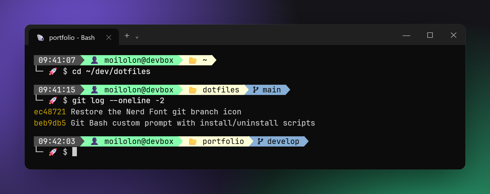

<div align="center">

# ⚡ dotfiles

**A two-line, powerline-style prompt for Git Bash on Windows.**

Time · user@host · current folder · git branch — at a glance, with zero dependencies.

[](https://gitforwindows.org/)
[](https://www.gnu.org/software/bash/)
[](https://www.microsoft.com/windows)
[](https://www.nerdfonts.com/)



</div>

---

## ✨ Features

|     | Segment       | What it shows                                                  |
| --- | ------------- | -------------------------------------------------------------- |
| 🕒  | **Time**      | When the prompt was drawn (`HH:MM:SS`)                         |
| 👤  | **User@host** | Who you are and on which machine                               |
| 📂  | **Folder**    | The current directory's name                                   |
| 🌿  | **Git branch** | Only inside a repository; the short hash on a detached HEAD   |
| 🚀  | **Input line** | A second line, so long paths never squeeze your command       |

- 🪶 **Lightweight** — plain Bash, no frameworks, no external binaries.
- 🏎️ **Fast** — the branch is read straight from `.git/HEAD`, no `git status` on every prompt.
- 🪟 **Window title** — the terminal tab shows the folder you're in.
- 🧩 **Non-invasive** — installs as one marked block in `~/.bashrc`; everything else stays yours.
- 🔁 **Idempotent** — re-run the installer any time (e.g. after moving the clone).

## 📋 Requirements

- **[Git Bash](https://gitforwindows.org/)** (Git for Windows).
- A **[Nerd Font](https://www.nerdfonts.com/)** set in your terminal — e.g. *JetBrainsMono Nerd Font*.

> [!TIP]
> No Nerd Font? Add `export USE_NERD_FONTS=false` to `~/.bashrc`, **above** the loader block,
> to fall back to plain icons.

## 🚀 Install

```bash
git clone https://github.com/moilolon/dotfiles.git
cd dotfiles
bash install.sh
```

Then restart Git Bash. The installer appends this block to `~/.bashrc`:

```bash
# >>> moilolon/dotfiles >>>
if [ -f "/path/to/dotfiles/bash/bashrc" ]; then
    source "/path/to/dotfiles/bash/bashrc"
fi
# <<< moilolon/dotfiles <<<
```

## 🎨 Customize

Everything lives in [`bash/prompt.sh`](bash/prompt.sh):

| Want to change…      | Edit                                                        |
| -------------------- | ----------------------------------------------------------- |
| Icons                | `DIR_ICON`, `USER_ICON`, `PROMPT_SYMBOL`, `GIT_ICON`, `ARROW` |
| Segment colors       | `BG_*` (background/foreground) and `ARR*` (arrow) variables  |
| Segment order/layout | `build_ps1()`                                                |

Colors use the 256-color palette (`48;5;N` background, `38;5;N` foreground).

## 🗑️ Uninstall

```bash
bash uninstall.sh
```

Removes only the marked block from `~/.bashrc` — nothing else is touched.

## 🗂️ Structure

```text
.
├── install.sh      # Adds the loader block to ~/.bashrc
├── uninstall.sh    # Removes that block
├── assets/
│   └── prompt.png  # Screenshot used in this README
└── bash/
    ├── bashrc      # Loader (guards against double loading)
    └── prompt.sh   # The prompt
```

<div align="center">

Made with ☕ by **[@moilolon](https://github.com/moilolon)**

</div>
