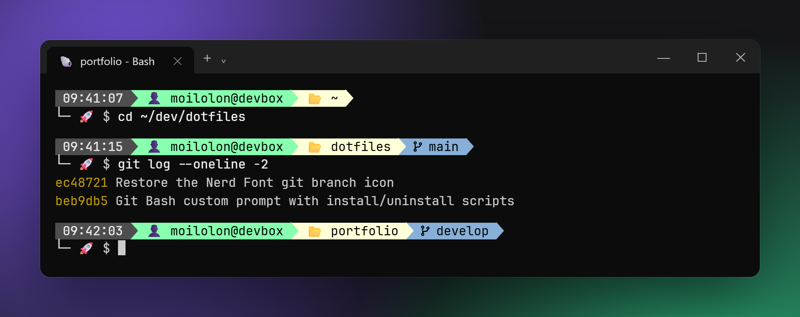

<div align="center">

# ⚡ dotfiles

**A two-line, powerline-style prompt for Git Bash on Windows**

[](https://gitforwindows.org/)
[](https://www.gnu.org/software/bash/)
[](https://www.nerdfonts.com/)



</div>

---

## ✨ What this is

| | Segment | What it shows |
|---|---|---|
| 🕒 | **Time** | When the prompt was drawn |
| 👤 | **User@host** | Who you are and on which machine |
| 📂 | **Folder** | The current directory's name, also in the window title |
| 🌿 | **Git branch** | Only inside a repository; the short hash on a detached HEAD |
| 🚀 | **Input line** | A second line, so long paths never squeeze your command |

---

## 🧭 How it works

- **Plain Bash**, with no frameworks or external binaries. The branch is read straight
  from `.git/HEAD`, with no `git status` on every prompt.
- **One marked block in `~/.bashrc`.** The installer adds it and the uninstaller removes
  only that block; both can be run again at any time.
- **Icons from a [Nerd Font](https://www.nerdfonts.com/).** Without one,
  `export USE_NERD_FONTS=false` above the block falls back to plain icons.
- **Colours, icons and segments** are all in `bash/prompt.sh`.

---

## 🚀 Getting started

```bash
git clone https://github.com/moilolon/dotfiles.git
cd dotfiles
bash install.sh     # bash uninstall.sh removes it
```

Then restart Git Bash.

---

<div align="center">
<sub><a href="https://moilolon.com">moilolon.com</a> · <a href="https://github.com/moilolon">@moilolon</a></sub>
</div>
